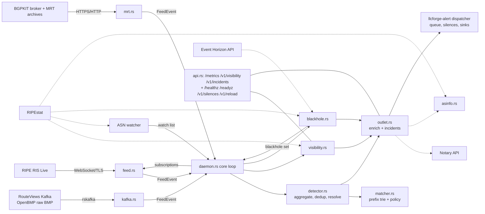

# Vigil Architecture

Real-time origin hijack detection over public route collector feeds (RIPE RIS Live, the RouteViews BMP stream over Kafka, MRT update files). Flags the moment someone else announces your prefix.

This document describes how Vigil is put together, where its trust boundaries are and how it behaves when things go wrong. It is the starting point for contributors; keep it up to date when you change the design.

## Design principles

- **Self-hosted, single binary, pure Rust.** No SaaS dependency, no database, no C libraries (rustls/ring, rskafka, bgpkit-parser, miniz_oxide, libbz2-rs). Runs on Linux, macOS and Windows.
- **Small, explicit state on disk.** Route state lives in memory and is rebuilt from the feeds after a restart. Only the alert queue, silences and the incident timeline are persisted under `data_dir`.
- **Fail safe and loud.** A feed outage longer than the grace period raises `feed_down`; silence is never treated as "all clear".
- **Untrusted input everywhere.** Feed data, MRT files, Kafka records and every HTTP response are parsed defensively with explicit size limits. No `unsafe` code (`#![deny(unsafe_code)]`).
- **Optional integrations never delay alerts.** Notary, RIPEstat and Event Horizon calls are time-boxed and run off the detection path.
- **Secrets from the environment.** Only names of environment variables appear in the config.

## Data flow



## Components (`src/`)

| File | Responsibility |
|---|---|
| `main.rs` | CLI: `run`, `check-config`, `replay`, `replay-mrt`, `incidents`, `kafka-topics`, `silence`, `service`. |
| `daemon.rs` | Runtime wiring for `run` / `service run`: feeds, core loop, pollers (ASN prefixes, visibility, Event Horizon), management listener, reload (dispatcher restart, watch-list rebuild), graceful shutdown. |
| `config.rs` | TOML config with `deny_unknown_fields`, full validation at startup; the kit's `[alerts]`, `[silences]`, `[health]`; rejects the pre-0.2 alert keys with a migration hint. |
| `ris.rs` | RIS Live message model and parser; origin and origin-neighbour (upstream) extraction. |
| `feed.rs` | RIS Live client: subscribes every watched prefix (and blackhole route) with `moreSpecific`, follows watch-list changes on the open session with `ris_subscribe` / `ris_unsubscribe`, pings, reconnects with jittered backoff; `Outage` bookkeeping shared with the other feeds. |
| `kafka.rs` | RouteViews Kafka consumer: lists topics, selects them by glob (capped), one task per partition starting at the latest offset; decodes OpenBMP v1.7 + BMP Route Monitoring with bgpkit-parser under `catch_unwind`; forwards only updates covered by the watch list. |
| `mrt.rs` | bgpkit-parser glue: element conversion, gzip/bzip2 sniffing, RIS archive URL generation for `replay-mrt`, BGPKIT broker polling with a host allowlist and size-capped downloads. |
| `matcher.rs` | Longest-prefix trie per address family; origin, `max_length`, dormant space, scrubbing providers and time-boxed exceptions. |
| `detector.rs` | Aggregation per `(kind, prefix, origin)`, dedup, MOAS, unexpected upstream, blackhole exemption; keeps fired alerts open and emits a resolution once their route has been gone for `resolve_after_secs`. |
| `visibility.rs` | Per-prefix visibility from RIPEstat routing-status, adjusted live by peer withdrawals; `visibility_loss` alerts and gauges. |
| `blackhole.rs` | Event Horizon poller and verifier (live sightings + RIPEstat looking glass). |
| `ripestat.rs` | RIPEstat client (routing-status, announced-prefixes, as-overview, rir-stats-country, looking-glass) with body caps and pure parsers. |
| `asinfo.rs` | AS holder name and country: local CSV, then RIPEstat, TTL cache. |
| `notary.rs` | Notary `GET /v1/validity`: `state` first, older shapes as fallback, `stale` flag. |
| `outlet.rs` | Enrichment in bounded background tasks, incident recording, hand-off to the dispatcher. |
| `incidents.rs` | Incident timeline (bounded, atomic JSON file). |
| `api.rs` | Read-only HTTP API and `/metrics` (merged with the kit's health, silence and reload routers). |
| `alert.rs` | Route alert model, text rendering, conversion to `llcforge.alert.v1`. |
| `metrics.rs` | Process counters in Prometheus text format. |
| `replay.rs` | Deterministic offline replay (RIS Live JSON and MRT). |

## Detection rules

For an announcement of prefix `P` with origin `O`, covered by the most specific watched prefix `W`:

1. `W` is dormant: **squatting**, unless an exception covers `O`.
2. `len(P) > W.max_length`: **sub-prefix hijack**, whatever `O` is, unless excepted, or `P` is an active Event Horizon blackhole announced by one of `W.origins`.
3. `O` is an AS_SET: **ambiguous origin**.
4. `O` in `W.origins`: fine, unless `W.upstreams` is set and the neighbour of `O` in the path (prepends ignored) is not in it: **unexpected upstream**.
5. An active exception, or `O` is a scrubbing provider with `scrubbing = "allow"`: fine.
6. `O` is a scrubbing provider with `scrubbing = "warn"`: **scrubbing origin**.
7. Otherwise: **origin hijack**.

Independently, when two or more origins currently announce `P` (one per peer; withdrawals remove them) and one of them breaks the rules above, a **MOAS** alert is raised.

A fired alert stays open while any tracked peer still carries the offending route; after `resolve_after_secs` without it, the alert is re-sent with the same id and `resolved = true`, and the dedup entry is cleared so a recurrence alerts again.

## Trust boundaries

- **RIS Live -> Vigil.** Untrusted. Frames over 1 MiB refused; at most 10,000 prefixes and 512 path segments per message; collector, peer and timestamp validated. Anything else is dropped and counted.
- **Kafka (RouteViews) -> Vigil.** Untrusted, unauthenticated plaintext. Records over 4 MiB are ignored; the OpenBMP/BMP/BGP decoder runs under `catch_unwind`; malformed records are counted. Topic count is capped (`max_topics`).
- **BGPKIT broker and MRT archives -> Vigil.** Untrusted. Broker responses capped at 4 MiB; file URLs must be http(s) on an allow-listed host (default `routeviews.org`, `ripe.net`; no redirects followed); downloads capped (`max_file_bytes`) and streamed to a temporary file that is always removed; parsing runs in a blocking task whose panics are contained.
- **RIPEstat, Notary, Event Horizon -> Vigil.** Untrusted. Bodies capped, every call time-boxed, strings (AS names, countries, RPKI states) allowlisted or reduced to printable ASCII before they reach alerts.
- **Vigil -> sinks.** Escaping and signing are done by llcforge-alert (Telegram HTML escaping, HMAC webhook signatures, no redirects).
- **Management listener.** `/metrics`, `/healthz`, `/readyz` are unauthenticated read-only; `/v1/visibility` and `/v1/incidents` take an optional bearer token (`[api] token_env`); `/v1/silences` and `POST /v1/reload` are only mounted with their own token. Request bodies are capped at 1 KiB on Vigil's routes. Bind to localhost or a management network.

## Failure modes

| Situation | Behaviour |
|---|---|
| Feed disconnect / no data | Reconnect with jittered backoff; `feed_down` after `feed_down_grace_secs`, resolution when it is back; `/readyz` reports the feed. |
| Kafka partition error | That partition reconnects with backoff and resumes at the latest offset (a gap is possible); metadata failures count towards `feed_down`. |
| MRT download or parse failure | File skipped, `vigil_mrt_failures_total` incremented; the next poll continues. |
| Malformed or oversized message / record | Dropped and counted; the session continues. |
| RIPEstat / Notary / Event Horizon slow or down | The alert goes out without enrichment after the timeout; ASN lists keep their last good value; visibility keeps its last measurement. |
| Sink failure | Handled by llcforge-alert: retries, persistent queue, redelivery; other sinks unaffected. |
| Flood of distinct hijacked more-specifics | State tables capped (65,536 tracked prefixes, 10,000 pending and 10,000 open alerts, 1,000 incidents); overflow is counted in `vigil_sightings_dropped_total`. |
| Invalid config on reload | Rejected and logged; the running configuration stays. Feed, listener and `data_dir` changes need a restart. |

## Runtime model

- Tokio multi-threaded runtime. Feed tasks (RIS Live, one per Kafka partition, BGPKIT poller) send `FeedEvent`s through one bounded channel (4,096) to the core loop, which owns the detector and flushes once per second.
- Watch lists flow back through `watch` channels: the core publishes the subscription list (watched prefixes plus uncovered blackhole routes); the ASN watcher and the Event Horizon poller publish their sets to the core.
- Alerts are handed to the llcforge-alert dispatcher through a non-blocking handle; enrichment runs in at most 32 concurrent tasks.
- Graceful shutdown on Ctrl+C, `SIGTERM` or the Windows service stop: feeds stop, the detector flushes, enrichment drains, then the dispatcher drains (bounded).

## Repository layout

```
Vigil/
├── .github/                  CI (Linux, macOS, Windows), release, dependabot
├── crates/llcforge-alert/    vendored shared alert kit (sync.py)
├── deploy/                   Grafana dashboard, Prometheus rules, Helm chart
├── packaging/                deb/rpm fragment, systemd, launchd, Homebrew, Scoop, winget, Windows service
├── examples/                 RIS Live samples for `vigil replay`
├── src/                      application source (see Components)
├── tests/replay.rs           end-to-end replay tests
├── Dockerfile, docker-compose.yml
└── vigil.example.toml        annotated example configuration
```

## Related tools

- [Pathology](https://github.com/LLCForge/Pathology): BGP route monitor for your own routers and BMP feeds.
- [Event Horizon](https://github.com/LLCForge/Event-Horizon): DDoS detection and RTBH; Vigil verifies its blackholes from outside.
- [Notary](https://github.com/LLCForge/Notary): RPKI Route Origin Validation checker.
- [Herald](https://github.com/LLCForge/Herald): Certificate Transparency log monitor.
