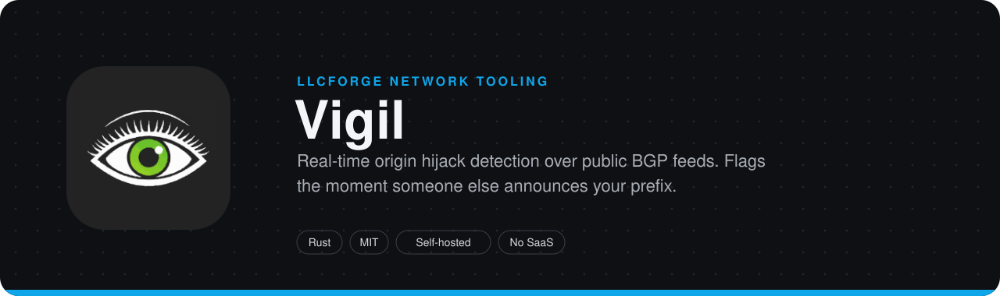
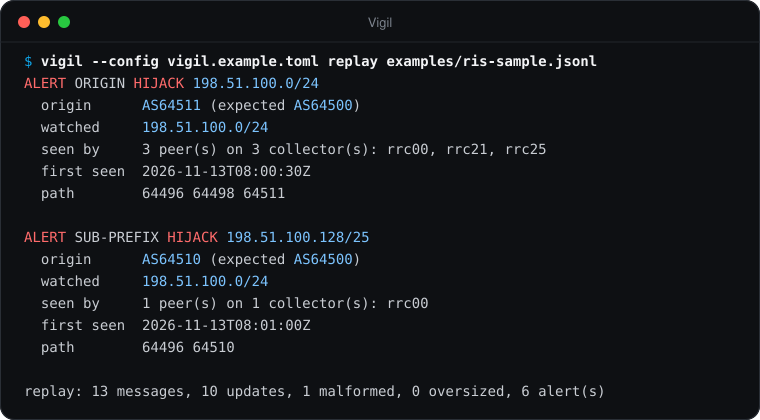
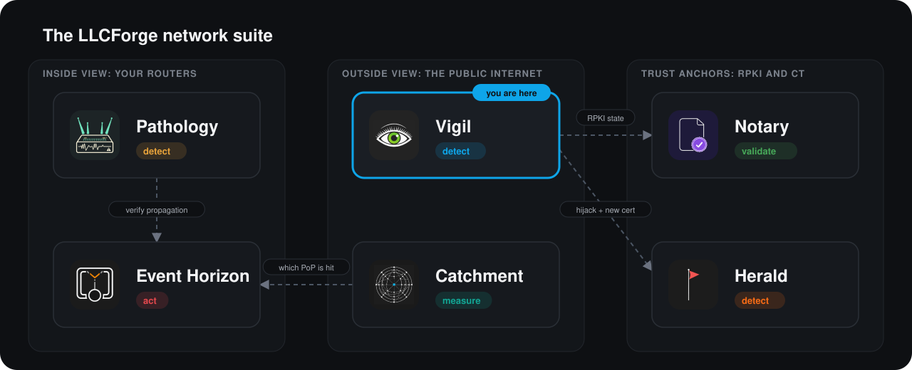

> **LLCForge network tooling** — self-hosted, Rust, no SaaS.
> [Pathology](https://github.com/LLCForge/Pathology) · [Event Horizon](https://github.com/LLCForge/Event-Horizon) · [Catchment](https://github.com/LLCForge/Catchment) · [Notary](https://github.com/LLCForge/Notary) · [Herald](https://github.com/LLCForge/Herald) · **Vigil**

<!-- readme-visuals -->
<p align="center">
  
</p>

<p align="center">Real-time origin hijack detection over public route collector feeds: RIPE RIS Live, the RouteViews BMP stream and MRT archives. Flags the moment someone else announces your prefix.</p>

<p align="center">
  <strong>English</strong> · <a href="README.tr.md">Türkçe</a>
</p>

<p align="center">
  <a href="LICENSE"></a>
  
  
</p>

---

## Why

If another AS starts originating your prefix, or a more-specific of it, traffic from part of the Internet goes to them instead of you. You cannot see this from your own routers because the bad route never reaches you. Vigil watches hundreds of public BGP peers in real time and alerts within seconds of the first announcement, with zero access to your network required.

## Demo

<p align="center">
  
</p>

<sub>Real output of `vigil --config vigil.example.toml replay examples/ris-sample.jsonl` on sample data that uses documentation address ranges and private ASNs (2 of 6 alerts shown).</sub>

## Features

**Feeds** (any combination; all pure Rust, no system libraries)

- **RIPE RIS Live** over WebSocket (rustls). Vigil subscribes server-side to each watched prefix and its more-specifics and follows watch-list changes on the open session.
- **RouteViews BMP stream over Kafka** (`rskafka` + `bgpkit-parser`): OpenBMP raw BMP messages, topics selected by glob (`routeviews.amsix.*.bmp_raw`). `vigil kafka-topics` lists what your globs match.
- **MRT update files via the BGPKIT broker** (RouteViews and RIS collectors, minutes of delay), downloaded only from allow-listed archive hosts.
- **Historical replay** of the RIS MRT archive for a date range (`vigil replay-mrt --collector rrc00 --from … --to …`) or of local MRT files, and of saved RIS Live JSON.

**Detection**

- Exact-prefix **origin hijacks**, **sub-prefix hijacks** (beyond `max_length`, whatever origin they claim), **MOAS**, **AS_SET** origins (flagged, not guessed).
- **Squatting:** announcements of registered but unannounced (`dormant = true`) space.
- **Expected upstreams:** a route whose neighbour of the origin is not in `upstreams` is reported (simple leak detection).
- **Scrubbing providers:** a built-in, documented, overridable list of DDoS mitigation ASNs (see below); their announcements of your space become a `scrubbing_origin` warning instead of a critical hijack (or no alert, or a normal hijack).
- Time-boxed `[[exception]]` entries, longest-prefix matching over IPv4 and IPv6.
- **Watch by ASN:** `[[asn]]` fetches the prefixes your AS originates from RIPEstat and refreshes them.
- **Event Horizon blackholes:** polls Event Horizon's `GET /v1/blackholes`, subscribes the /32 and /128 routes, and alerts when a blackhole is not visible at any RIS peer after a grace period. Your own RTBH more-specifics are not reported as sub-prefix hijacks.
- **Visibility:** share of RIS full-feed peers that carry each watched prefix (RIPEstat routing-status, adjusted live by peer withdrawals); `visibility_loss` alert below `min_ratio`, Prometheus gauge and `GET /v1/visibility`.

**Alerts and operations** (shared [llcforge-alert](crates/llcforge-alert) kit)

- Aggregation (peers, collectors, first seen) and dedup; **resolution** with the same alert id once the route has been gone for `resolve_after_secs`.
- **Incident timeline** (`vigil incidents`, `GET /v1/incidents`), persisted.
- Enrichment: **RPKI state** from [Notary](https://github.com/LLCForge/Notary) and **AS names + country** (local CSV, then RIPEstat, cached); each lookup is time-boxed and never delays an alert.
- Sinks: stdout, webhook (HMAC-signed), Telegram, Slack, Discord, Teams, e-mail, PagerDuty, Opsgenie, **syslog**; per-sink filters give **per-prefix-group recipients** (`resources = ["core/*"]`). Persistent queue, silences (`vigil silence add|list|remove` and API), `/healthz` `/readyz`, **JSON or text logs**, config reload (SIGHUP, file change, `POST /v1/reload`), `vigil service install|uninstall|run`.
- Prometheus metrics, Grafana dashboard and alerting rules in [`deploy/`](deploy).
- No router access, no BGP session, no credentials to your network.

## Where it fits in the suite

**Vigil vs. [Pathology](https://github.com/LLCForge/Pathology):** both catch hijacks, but from opposite ends. Vigil is *fast, shallow* detection from **public feeds** (RIPE RIS, RouteViews): it checks prefix, origin and the neighbour of the origin, needs no router access and is the first to see a hijack that never reaches your network. Pathology is *deep* monitoring from **your own infrastructure** (BMP / BGP): full AS paths, communities and learned baselines. Use Vigil for the outside view, Pathology for the inside view.

<p align="center">
  
</p>

Cross-tool contracts: Vigil **serves** `GET /v1/visibility?prefix=<p>` → `{"prefix","peers_seeing","peers_total","ratio","as_of"}`; it **calls** Notary `GET /v1/validity` (field `state`, falling back to older field names; `stale: true` is shown as `(stale)`) and Event Horizon `GET /v1/blackholes`. Every call is optional, time-boxed and never delays an alert.

## Installation

Release archives, packages and images are built by [`.github/workflows/release.yml`](.github/workflows/release.yml) for Linux (x86_64/aarch64, glibc and musl), macOS (Intel and Apple silicon) and Windows (x86_64 and ARM64).

- **Linux, deb/rpm:** `sudo apt install ./vigil_*.deb` or `sudo dnf install ./vigil-*.rpm`. The package installs `/usr/bin/vigil`, `/etc/vigil/vigil.toml` and the hardened systemd unit (not enabled). Put secrets in `/etc/vigil/vigil.env` (mode 0600), then `sudo systemctl enable --now vigil`. `systemctl reload vigil` reloads the configuration.
- **macOS, Homebrew:** `brew install llcforge/tap/vigil`; run under launchd with `brew services start vigil` or the plist in [`packaging/launchd`](packaging/launchd).
- **Windows:** `scoop install vigil` (bucket manifest in [`packaging/scoop`](packaging/scoop)) or `winget install LLCForge.Vigil`; install the Windows service from an elevated PowerShell with [`packaging/windows/install-service.ps1`](packaging/windows/install-service.ps1), or `vigil service install --config C:\ProgramData\LLCForge\vigil\vigil.toml`.
- **Docker:** `docker compose up -d` with [`docker-compose.yml`](docker-compose.yml) (read-only root, no capabilities, `/data` volume). Set `[health] listen = "0.0.0.0:9184"` in the mounted config so the published port works.
- **Kubernetes:** `helm install vigil deploy/helm/vigil` (config in `values.yaml`, probes on `/healthz` and `/readyz`, optional ServiceMonitor).
- **From source:** a stable Rust toolchain (1.88+), `cargo build --release`. No system libraries on Linux, macOS or Windows.

Vigil needs no special privileges on any OS: it only opens outbound TCP connections (443 to RIS Live / RIPEstat / BGPKIT, 80 to the RouteViews archive, 9092 to the RouteViews Kafka brokers) and its own management listener.

## Quick start

> **Status:** pre-release. Configuration keys and CLI flags may change before 1.0.

```bash
git clone https://github.com/LLCForge/Vigil.git
cd Vigil
cargo build --release
cp vigil.example.toml vigil.toml   # then edit prefixes and origins
./target/release/vigil --config vigil.toml check-config
./target/release/vigil --config vigil.toml run
```

Try it offline first, with the bundled samples (documentation prefixes and ASNs):

```bash
./target/release/vigil --config vigil.example.toml replay examples/ris-sample.jsonl
./target/release/vigil --config vigil.example.toml replay examples/ris-squat.jsonl
```

## Usage

```text
Usage: vigil [OPTIONS] <COMMAND>

Commands:
  run           Watch the configured feeds and send alerts until stopped
  check-config  Validate the configuration (and required environment variables) and exit
  replay        Run saved RIS Live messages (JSON lines) through the detector offline
  replay-mrt    Replay MRT update files: local files, or a RIS archive date range
  incidents     Show the incident timeline recorded by `vigil run`
  kafka-topics  List Kafka topics matched by [feeds.routeviews_kafka]
  silence       Manage silences (maintenance windows)
  service       Install, uninstall or run as a system service
  help          Print this message or the help of the given subcommand(s)

Options:
  -c, --config <CONFIG>  Path to the TOML configuration file [default: vigil.toml]
  -h, --help             Print help
  -V, --version          Print version
```

`run` stops cleanly on Ctrl+C or SIGTERM, flushing pending alerts first. `replay` and `replay-mrt` use message timestamps as their clock, print alerts to stdout and never send to sinks. `replay-mrt --collector rrc00 --from 2026-11-01T00:00:00Z --to 2026-11-01T06:00:00Z` downloads the 5-minute RIS update files of that range (at most 7 days) and skips missing ones. Logs go to stderr.

## Configuration

Full example: [`vigil.example.toml`](vigil.example.toml). Addresses and ASNs are documentation values; replace them with your own. Unknown keys are rejected and the whole file is validated at startup. Secrets are never in the file, only the names of environment variables (`*_env`).

```toml
[feeds]
ris_live = true
feed_down_grace_secs = 120

[feeds.routeviews_kafka]            # optional
brokers = ["stream.routeviews.org:9092"]
topics = ["routeviews.amsix.*.bmp_raw"]

[feeds.bgpkit]                      # optional
collectors = ["route-views2", "rrc00"]

[detection]
aggregation_window_secs = 10
dedup_secs = 3600
resolve_after_secs = 600
scrubbing = "warn"                  # warn | allow | off

[[prefix]]
prefix = "198.51.100.0/24"
origins = [64500]
max_length = 24
upstreams = [64496, 64497]          # optional expected neighbours of the origin
group = "core"                      # alert resource "core/198.51.100.0/24"

[[prefix]]
prefix = "192.0.2.0/24"
dormant = true                      # registered, never announced: squatting

[[asn]]                             # optional: watch all prefixes of an AS
asn = 64500

[[exception]]
origin = 64505
prefix = "198.51.100.0/24"
until = "2030-01-01T00:00:00Z"

[enrich.notary]
url = "http://127.0.0.1:8323"

[enrich.asnames]                    # RIPEstat as-overview + rir-stats-country
file = "/etc/vigil/asnames.csv"     # optional "asn,name,country" lines, consulted first

[visibility]
enabled = true
min_ratio = 0.5

[event_horizon]
url = "http://127.0.0.1:8080"
token_env = "EVENT_HORIZON_TOKEN"

[[alerts.sink]]
type = "telegram"
bot_token_env = "VIGIL_TELEGRAM_TOKEN"
chat_id = -1001234567890
resources = ["core/*"]              # this chat only gets the "core" group

[[alerts.sink]]
type = "syslog"
transport = "udp"
address = "127.0.0.1:514"

[log]
format = "json"

[health]
listen = "127.0.0.1:9184"           # /metrics, /healthz, /readyz, /v1/*
```

Without any `[[alerts.sink]]`, alerts go to stdout as before. The pre-0.2 `[alerts] stdout/telegram/webhook` keys are rejected with a pointer to the new `[[alerts.sink]]` form; `[metrics] listen` is still accepted as an alias of `[health] listen`.

### Alert kinds

| Kind | Severity | Fires when |
|---|---|---|
| `origin_hijack` | critical | A watched prefix (or more-specific within `max_length`) is announced by an origin not in `origins` and not excepted. |
| `sub_prefix_hijack` | critical | A more-specific beyond `max_length` is announced, by any origin (except your own Event Horizon blackholes). |
| `squatting` | critical | Dormant space is announced. |
| `moas` | warning | Two or more origins announce the same prefix at once and one of them is not allowed. |
| `ambiguous_origin` | warning | The AS path ends in an AS_SET. |
| `scrubbing_origin` | warning | A known scrubbing provider originates your prefix (`scrubbing = "warn"`). |
| `unexpected_upstream` | warning | The neighbour of a legitimate origin is not in `upstreams`. |
| `visibility_loss` | warning | Fewer than `min_ratio` of RIS full-feed peers see the prefix. |
| `blackhole_not_visible` | warning | An Event Horizon blackhole is not seen by any RIS peer after `grace_secs`. |
| `feed_down` | warning | A feed has been unreachable longer than `feed_down_grace_secs`. |

Every alert has a stable id (`vigil:<kind>:<prefix>:<origin>`); when the condition clears, the same id is sent again with `resolved = true`.

### Built-in scrubbing providers

Holder names checked against RIPEstat as-overview on 2026-11-13. Override with `detection.scrubbing_asns`.

| ASN | Provider |
|---|---|
| AS13335 | Cloudflare (Magic Transit) |
| AS19551 | Imperva / Incapsula |
| AS19905 | Vercara (UltraDDoS Protect) |
| AS32787 | Akamai Prolexic |
| AS55002 | F5 Silverline (Defense.Net) |

### RouteViews Kafka: what was verified

Verified on 2026-11-13: `stream.routeviews.org:9092` answers Kafka metadata requests without authentication, topics follow `routeviews.<collector>.<peer-asn>.bmp_raw` (the `routeviews.amsix.*.bmp_raw` glob matched 139 topics), and records are OpenBMP v1.7 headers with raw BMP messages, decoded by Vigil without errors (about 20,000 records per 40 s on that glob). Sources: the topic scheme as described by the BGPStream maintainers and the bgpkit-parser RouteViews Kafka example; RouteViews itself documents the stream only in presentations. TLS and SASL are not used by that endpoint and are not implemented; compressed record batches are supported with gzip and snappy only (no lz4/zstd, to stay free of C libraries).

## Roadmap

- Kafka TLS/SASL and lz4/zstd record batches (not needed for the public RouteViews endpoint today).
- BMP Peer Down handling: today a route stays "current" until it is withdrawn or replaced, so an incident whose only carrier peer goes down is resolved late.
- Visibility counts RIS peers only (RIPEstat routing-status); RouteViews peers are not part of the ratio.

## How it works

See [ARCHITECTURE.md](ARCHITECTURE.md) for components, data flow, trust boundaries and failure modes.

## Related tools

- [Pathology](https://github.com/LLCForge/Pathology): BGP route monitor for your own routers and BMP feeds.
- [Event Horizon](https://github.com/LLCForge/Event-Horizon): DDoS detection and RTBH; Vigil checks its blackholes from the outside.
- [Notary](https://github.com/LLCForge/Notary): RPKI Route Origin Validation checker; Vigil adds its verdict to alerts.
- [Herald](https://github.com/LLCForge/Herald): Certificate Transparency log monitor.

## Contributing

Issues and pull requests are welcome. Read [CONTRIBUTING.md](CONTRIBUTING.md) and the [Code of Conduct](CODE_OF_CONDUCT.md) first. Found a vulnerability? Do **not** open a public issue; follow [SECURITY.md](SECURITY.md).

## License

Vigil is free and open-source software released under the [MIT License](LICENSE). See [NOTICE](NOTICE) for attributions.
