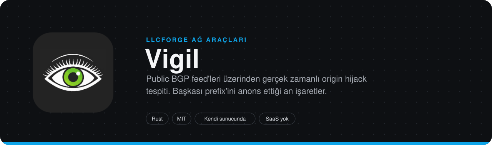
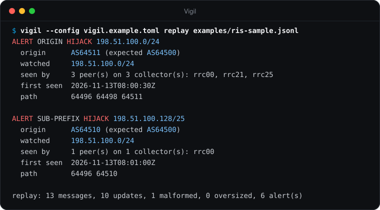
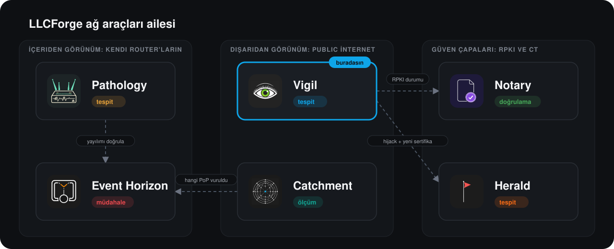

> **LLCForge ağ araçları** — kendi sunucunda, Rust, SaaS yok.
> [Pathology](https://github.com/LLCForge/Pathology) · [Event Horizon](https://github.com/LLCForge/Event-Horizon) · [Catchment](https://github.com/LLCForge/Catchment) · [Notary](https://github.com/LLCForge/Notary) · [Herald](https://github.com/LLCForge/Herald) · **Vigil**

<!-- readme-visuals -->
<p align="center">
  
</p>

<p align="center">Public route collector feed'leri üzerinden gerçek zamanlı origin hijack tespiti: RIPE RIS Live, RouteViews BMP akışı ve MRT arşivleri. Başka biri prefix'ini anons ettiği an işaretler.</p>

<p align="center">
  <a href="README.md">English</a> · <strong>Türkçe</strong>
</p>

<p align="center">
  <a href="LICENSE"></a>
  
  
</p>

---

## Neden

Başka bir AS prefix'ini ya da onun daha spesifik bir parçasını origin etmeye başlarsa, İnternet'in bir kısmından gelen trafik sana değil ona gider. Bunu kendi router'larından göremezsin çünkü kötü rota sana hiç ulaşmaz. Vigil yüzlerce public BGP peer'ını gerçek zamanlı izler ve ağına hiçbir erişim gerektirmeden ilk anonstan saniyeler sonra alarm verir.

## Örnek çıktı

<p align="center">
  
</p>

<sub>`vigil --config vigil.example.toml replay examples/ris-sample.jsonl` komutunun, dokümantasyon adres aralıkları ve özel ASN'ler kullanan örnek veri üzerindeki gerçek çıktısı (6 alarmdan 2'si gösteriliyor).</sub>

## Özellikler

**Feed'ler** (istediğin kombinasyonda; hepsi saf Rust, sistem kütüphanesi yok)

- **RIPE RIS Live**, WebSocket üzerinden (rustls). Vigil izlenen her prefix'e ve more-specific'lerine sunucu tarafında abone olur; izleme listesi değişince açık oturumda aboneliği günceller.
- **Kafka üzerinden RouteViews BMP akışı** (`rskafka` + `bgpkit-parser`): OpenBMP raw BMP mesajları, topic'ler glob ile seçilir (`routeviews.amsix.*.bmp_raw`). Glob'larının neyle eşleştiğini `vigil kafka-topics` listeler.
- **BGPKIT broker üzerinden MRT update dosyaları** (RouteViews ve RIS collector'ları, birkaç dakika gecikmeyle); yalnızca izin verilen arşiv host'larından indirilir.
- **Geçmişe dönük oynatma:** bir tarih aralığı için RIS MRT arşivi (`vigil replay-mrt --collector rrc00 --from … --to …`), yerel MRT dosyaları ve kaydedilmiş RIS Live JSON'u.

**Tespit**

- Birebir prefix **origin hijack**, **sub-prefix hijack** (`max_length` sınırını aşan her anons, hangi origin'i iddia ederse etsin), **MOAS**, **AS_SET** origin'leri (tahmin edilmez, işaretlenir).
- **Squatting:** kayıtlı ama anons edilmeyen (`dormant = true`) adres alanının anonsu.
- **Beklenen upstream'ler:** origin'in komşusu `upstreams` listesinde olmayan rota bildirilir (basit leak tespiti).
- **Scrubbing sağlayıcıları:** belgelenmiş ve değiştirilebilir yerleşik bir DDoS koruma ASN listesi (aşağıda); bunların senin prefix'ini anons etmesi kritik hijack yerine `scrubbing_origin` uyarısı olur (ya da hiç alarm olmaz, ya da normal hijack sayılır).
- Süreli `[[exception]]` kayıtları, IPv4 ve IPv6 üzerinde en uzun prefix eşleşmesi.
- **ASN ile izleme:** `[[asn]]`, AS'inin origin ettiği prefix'leri RIPEstat'tan çeker ve periyodik olarak yeniler.
- **Event Horizon blackhole'ları:** Event Horizon'ın `GET /v1/blackholes` uç noktasını yoklar, /32 ve /128 rotalarına abone olur ve bir blackhole bekleme süresinden sonra hiçbir RIS peer'ında görünmüyorsa alarm verir. Kendi RTBH more-specific'lerin sub-prefix hijack olarak bildirilmez.
- **Görünürlük:** her izlenen prefix'i taşıyan RIS full-feed peer oranı (RIPEstat routing-status, peer bazlı withdrawal'larla canlı düzeltilir); `min_ratio` altına inince `visibility_loss` alarmı, Prometheus metriği ve `GET /v1/visibility`.

**Alarm ve işletim** (ortak [llcforge-beacon](crates/llcforge-beacon) kiti)

- Birleştirme (peer, collector, ilk görülme) ve tekilleştirme; rota `resolve_after_secs` boyunca kaybolduktan sonra aynı alarm id'si ile **çözüldü** bildirimi.
- **Olay zaman çizelgesi** (`vigil incidents`, `GET /v1/incidents`), diske kaydedilir.
- Zenginleştirme: [Notary](https://github.com/LLCForge/Notary)'den **RPKI durumu**, **AS adı + ülke** (önce yerel CSV, sonra RIPEstat, önbellekli); her sorgu zaman sınırlıdır ve alarmı asla geciktirmez.
- Çıkışlar: stdout, webhook (HMAC imzalı), Telegram, Slack, Discord, Teams, e-posta, PagerDuty, Opsgenie, **syslog**; çıkış başına filtrelerle **prefix grubuna göre alıcı** (`resources = ["core/*"]`). Kalıcı kuyruk, susturmalar (`vigil silence add|list|remove` ve API), `/healthz` `/readyz`, **JSON veya metin log**, yapılandırmayı yeniden yükleme (SIGHUP, dosya değişikliği, `POST /v1/reload`), `vigil service install|uninstall|run`.
- Prometheus metrikleri, Grafana panosu ve alarm kuralları [`deploy/`](deploy) altında.
- Router erişimi yok, BGP oturumu yok, ağına hiçbir kimlik bilgisi yok.

## Ailedeki yeri

**Vigil ve [Pathology](https://github.com/LLCForge/Pathology) farkı:** ikisi de hijack yakalar ama zıt uçlardan. Vigil **public feed'lerden** (RIPE RIS, RouteViews) *hızlı ve sığ* tespit yapar: prefix'i, origin'i ve origin'in komşusunu kontrol eder, router erişimi gerektirmez ve ağına hiç ulaşmayan bir hijack'i ilk gören odur. Pathology ise **kendi altyapından** (BMP / BGP) *derin* izleme yapar: tam AS path'ler, community'ler ve öğrenilmiş baseline'lar. Dışarıdan görünüm için Vigil'i, içeriden görünüm için Pathology'yi kullan.

<p align="center">
  
</p>

Araçlar arası sözleşmeler: Vigil `GET /v1/visibility?prefix=<p>` → `{"prefix","peers_seeing","peers_total","ratio","as_of"}` **sunar**; Notary `GET /v1/validity` (önce `state` alanı, yoksa eski alan adları; `stale: true` ise `(stale)` olarak gösterilir) ve Event Horizon `GET /v1/blackholes` **çağırır**. Her çağrı isteğe bağlıdır, zaman sınırlıdır ve alarmı asla geciktirmez.

## Kurulum

Sürüm arşivleri, paketler ve imajlar [`.github/workflows/release.yml`](.github/workflows/release.yml) ile Linux (x86_64/aarch64, glibc ve musl), macOS (Intel ve Apple silicon) ve Windows (x86_64 ve ARM64) için üretilir.

- **Linux, deb/rpm:** `sudo apt install ./vigil_*.deb` ya da `sudo dnf install ./vigil-*.rpm`. Paket `/usr/bin/vigil`, `/etc/vigil/vigil.toml` ve sıkılaştırılmış systemd unit'ini kurar (etkinleştirmez). Gizli değerleri `/etc/vigil/vigil.env` dosyasına koy (izin 0600), sonra `sudo systemctl enable --now vigil`. `systemctl reload vigil` yapılandırmayı yeniden yükler.
- **macOS, Homebrew:** `brew install llcforge/tap/vigil`; launchd altında `brew services start vigil` ya da [`packaging/launchd`](packaging/launchd) içindeki plist ile çalıştır.
- **Windows:** `scoop install vigil` ([`packaging/scoop`](packaging/scoop) manifesti) ya da `winget install LLCForge.Vigil`; Windows servisini yönetici PowerShell'den [`packaging/windows/install-service.ps1`](packaging/windows/install-service.ps1) ile ya da `vigil service install --config C:\ProgramData\LLCForge\vigil\vigil.toml` ile kur.
- **Docker:** [`docker-compose.yml`](docker-compose.yml) ile `docker compose up -d` (salt okunur kök dosya sistemi, yetki yok, `/data` volume'u). Yayınlanan portun çalışması için bağlanan yapılandırmada `[health] listen = "0.0.0.0:9184"` ayarla.
- **Kubernetes:** `helm install vigil deploy/helm/vigil` (yapılandırma `values.yaml` içinde, `/healthz` ve `/readyz` probe'ları, isteğe bağlı ServiceMonitor).
- **Kaynaktan:** kararlı Rust araç zinciri (1.88+), `cargo build --release`. Linux, macOS ve Windows'ta sistem kütüphanesi gerekmez.

Vigil hiçbir işletim sisteminde özel yetki istemez: yalnızca dışa TCP bağlantısı açar (RIS Live / RIPEstat / BGPKIT için 443, RouteViews arşivi için 80, RouteViews Kafka broker'ları için 9092) ve kendi yönetim dinleyicisini açar.

## Hızlı başlangıç

> **Durum:** yayın öncesi. 1.0 öncesinde yapılandırma anahtarları ve CLI bayrakları değişebilir.

```bash
git clone https://github.com/LLCForge/Vigil.git
cd Vigil
cargo build --release
cp vigil.example.toml vigil.toml   # sonra prefix ve origin'leri düzenle
./target/release/vigil --config vigil.toml check-config
./target/release/vigil --config vigil.toml run
```

Önce çevrimdışı dene; örnek dosyalar dokümantasyon prefix'leri ve ASN'leri kullanır:

```bash
./target/release/vigil --config vigil.example.toml replay examples/ris-sample.jsonl
./target/release/vigil --config vigil.example.toml replay examples/ris-squat.jsonl
```

## Kullanım

```text
Usage: vigil [OPTIONS] <COMMAND>

Commands:
  run           Watch the configured feeds and send alerts until stopped
  check-config  Validate the configuration (and required environment variables) and exit
  replay        Run saved RIS Live messages (JSON lines) through the detector offline
  replay-mrt    Replay MRT update files: local files, or a RIS archive date range
  incidents     Show the incident timeline recorded by `vigil run`
  kafka-topics  List Kafka topics matched by [feeds.routeviews_kafka]
  silence       Manage silences (maintenance windows)
  service       Install, uninstall or run as a system service
  help          Print this message or the help of the given subcommand(s)

Options:
  -c, --config <CONFIG>  Path to the TOML configuration file [default: vigil.toml]
  -h, --help             Print help
  -V, --version          Print version
```

`run`, Ctrl+C ya da SIGTERM ile bekleyen alarmları gönderdikten sonra temiz biçimde durur. `replay` ve `replay-mrt` saat olarak mesaj zaman damgalarını kullanır, alarmları stdout'a yazar ve hiçbir çıkışa göndermez. `replay-mrt --collector rrc00 --from 2026-11-01T00:00:00Z --to 2026-11-01T06:00:00Z` o aralığın 5 dakikalık RIS update dosyalarını indirir (en çok 7 gün), eksik olanları atlar. Loglar stderr'e gider.

## Yapılandırma

Tam örnek: [`vigil.example.toml`](vigil.example.toml). Adresler ve ASN'ler dokümantasyon değerleridir; kendi değerlerinle değiştir. Bilinmeyen anahtarlar reddedilir ve dosyanın tamamı açılışta doğrulanır. Gizli değerler dosyada asla yer almaz; yalnızca ortam değişkeni adları (`*_env`) yazılır.

```toml
[feeds]
ris_live = true
feed_down_grace_secs = 120

[feeds.routeviews_kafka]            # isteğe bağlı
brokers = ["stream.routeviews.org:9092"]
topics = ["routeviews.amsix.*.bmp_raw"]

[feeds.bgpkit]                      # isteğe bağlı
collectors = ["route-views2", "rrc00"]

[detection]
aggregation_window_secs = 10
dedup_secs = 3600
resolve_after_secs = 600
scrubbing = "warn"                  # warn | allow | off

[[prefix]]
prefix = "198.51.100.0/24"
origins = [64500]
max_length = 24
upstreams = [64496, 64497]          # isteğe bağlı: origin'in beklenen komşuları
group = "core"                      # alarm resource'u "core/198.51.100.0/24"

[[prefix]]
prefix = "192.0.2.0/24"
dormant = true                      # kayıtlı, hiç anons edilmiyor: squatting

[[asn]]                             # isteğe bağlı: bir AS'in tüm prefix'lerini izle
asn = 64500

[[exception]]
origin = 64505
prefix = "198.51.100.0/24"
until = "2030-01-01T00:00:00Z"

[enrich.notary]
url = "http://127.0.0.1:8323"

[enrich.asnames]                    # RIPEstat as-overview + rir-stats-country
file = "/etc/vigil/asnames.csv"     # isteğe bağlı "asn,ad,ülke" satırları, önce buna bakılır

[visibility]
enabled = true
min_ratio = 0.5

[event_horizon]
url = "http://127.0.0.1:8080"
token_env = "EVENT_HORIZON_TOKEN"

[[alerts.sink]]
type = "telegram"
bot_token_env = "VIGIL_TELEGRAM_TOKEN"
chat_id = -1001234567890
resources = ["core/*"]              # bu sohbet yalnızca "core" grubunu alır

[[alerts.sink]]
type = "syslog"
transport = "udp"
address = "127.0.0.1:514"

[log]
format = "json"

[health]
listen = "127.0.0.1:9184"           # /metrics, /healthz, /readyz, /v1/*
```

Hiç `[[alerts.sink]]` yoksa alarmlar eskisi gibi stdout'a gider. 0.2 öncesi `[alerts] stdout/telegram/webhook` anahtarları, yeni `[[alerts.sink]]` biçimini gösteren bir hatayla reddedilir; `[metrics] listen` hâlâ `[health] listen` takma adı olarak kabul edilir.

### Alarm türleri

| Tür | Önem | Ne zaman |
|---|---|---|
| `origin_hijack` | critical | İzlenen bir prefix (ya da `max_length` içindeki more-specific'i) `origins` dışındaki ve istisnası olmayan bir origin tarafından anons edilir. |
| `sub_prefix_hijack` | critical | `max_length` sınırını aşan bir more-specific herhangi bir origin tarafından anons edilir (kendi Event Horizon blackhole'ların hariç). |
| `squatting` | critical | Kullanılmayan (dormant) adres alanı anons edilir. |
| `moas` | warning | Aynı prefix'i aynı anda iki ya da daha fazla origin anons eder ve en az biri izinsizdir. |
| `ambiguous_origin` | warning | AS path bir AS_SET ile biter. |
| `scrubbing_origin` | warning | Bilinen bir scrubbing sağlayıcısı prefix'ini origin eder (`scrubbing = "warn"`). |
| `unexpected_upstream` | warning | Meşru origin'in komşusu `upstreams` listesinde değildir. |
| `visibility_loss` | warning | Prefix'i RIS full-feed peer'larının `min_ratio` oranından azı görür. |
| `blackhole_not_visible` | warning | Bir Event Horizon blackhole'u `grace_secs` sonra hiçbir RIS peer'ında görünmez. |
| `feed_down` | warning | Bir feed `feed_down_grace_secs` süresinden uzun süre erişilemez. |

Her alarmın sabit bir id'si vardır (`vigil:<tür>:<prefix>:<origin>`); durum düzelince aynı id `resolved = true` ile yeniden gönderilir.

### Yerleşik scrubbing sağlayıcıları

Sahip adları 2026-11-13'te RIPEstat as-overview ile kontrol edildi. `detection.scrubbing_asns` ile değiştirilebilir.

| ASN | Sağlayıcı |
|---|---|
| AS13335 | Cloudflare (Magic Transit) |
| AS19551 | Imperva / Incapsula |
| AS19905 | Vercara (UltraDDoS Protect) |
| AS32787 | Akamai Prolexic |
| AS55002 | F5 Silverline (Defense.Net) |

### RouteViews Kafka: neler doğrulandı

2026-11-13'te doğrulandı: `stream.routeviews.org:9092` kimlik doğrulaması olmadan Kafka metadata isteklerine yanıt veriyor, topic adları `routeviews.<collector>.<peer-asn>.bmp_raw` biçiminde (`routeviews.amsix.*.bmp_raw` glob'u 139 topic ile eşleşti) ve kayıtlar OpenBMP v1.7 başlığı + ham BMP mesajı; Vigil bunları hatasız çözdü (bu glob ile 40 saniyede yaklaşık 20.000 kayıt). Kaynaklar: BGPStream geliştiricilerinin anlattığı topic şeması ve bgpkit-parser'ın RouteViews Kafka örneği; RouteViews akışı yalnızca sunumlarında belgeliyor. Bu uç nokta TLS ve SASL kullanmıyor, bunlar uygulanmadı; sıkıştırılmış kayıt grupları yalnızca gzip ve snappy ile destekleniyor (C kütüphanesi gerektirmemek için lz4/zstd yok).

## Yol haritası

- Kafka TLS/SASL ve lz4/zstd kayıt grupları (bugün public RouteViews uç noktası için gerekmiyor).
- BMP Peer Down işleme: şu an bir rota geri çekilene ya da değiştirilene kadar "güncel" sayılır; tek taşıyıcı peer'ı düşen bir olay geç çözülür.
- Görünürlük yalnızca RIS peer'larını sayar (RIPEstat routing-status); RouteViews peer'ları orana dahil değildir.

## Nasıl çalışır

Bileşenler, veri akışı, güven sınırları ve hata senaryoları için [ARCHITECTURE.md](ARCHITECTURE.md) dosyasına bak.

## İlgili araçlar

- [Pathology](https://github.com/LLCForge/Pathology): Kendi router'ların ve BMP beslemelerin için BGP rota izleyici.
- [Event Horizon](https://github.com/LLCForge/Event-Horizon): DDoS tespiti ve RTBH; Vigil onun blackhole'larını dışarıdan doğrular.
- [Notary](https://github.com/LLCForge/Notary): RPKI Route Origin Validation denetleyicisi; Vigil kararını alarmlara ekler.
- [Herald](https://github.com/LLCForge/Herald): Certificate Transparency log izleyici.

## Katkı

Issue ve pull request'ler memnuniyetle karşılanır. Önce [CONTRIBUTING.md](CONTRIBUTING.md) ve [Davranış Kuralları](CODE_OF_CONDUCT.md) dosyalarını oku. Bir güvenlik açığı mı buldun? Public issue **açma**; [SECURITY.md](SECURITY.md) adımlarını izle.

## Lisans

Vigil, [MIT Lisansı](LICENSE) ile yayınlanan özgür ve açık kaynak bir yazılımdır. Atıflar için [NOTICE](NOTICE) dosyasına bak.
